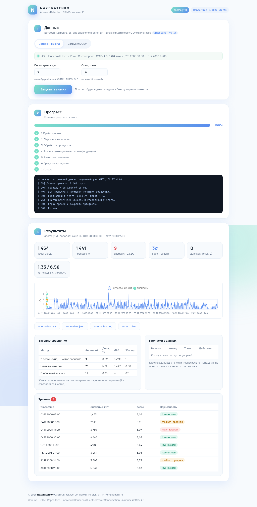

# SII-LR05-Nazdratenko · Поиск аномалий во временном ряде

[](https://www.python.org/)
[](https://fastapi.tiangolo.com/)
[](https://render.com/)
[](LICENSE)

Лабораторная работа №5 «Системы искусственного интеллекта» — **вариант 16**:
сценарий `energy` (потребление электроэнергии), метод **z-score**, окно **24**.

Сервис: данные → явная обработка пропусков → оценка аномальности → тревоги → отчёт.
Временной ряд рассматривается **как сервис**, а не только как статистическая задача:
веб-интерфейс с живым прогрессом по стадиям, CLI, конфигурируемый порог, baseline-сравнение, JSON-выдача с `model_version`.



---

## Возможности

- **Веб-интерфейс** (FastAPI + лёгкий SPA, ~120 МБ RAM): встроенный демо-ряд или загрузка своего CSV, живой прогресс по 7 стадиям с журналом расчёта, KPI, интерактивный график (Chart.js) с тревогами поцветно, таблицы тревог/пропусков/baseline, скачивание всех артефактов.
- **Конвейер**: разбор CSV (русские и английские заголовки, `дд.мм.гггг` и ISO), приведение к регулярной сетке, **явная политика пропусков** (короткие дыры интерполируются, длинные — остаются NaN и попадают в отчёт), скользящий z-score (окно 24), серьёзность тревог (low/medium/high), защита от константного ряда (flatline).
- **Baseline-сравнение**: наивный прогноз «вчера» + бонусом глобальный z-score — метрики: число тревог, доля, MAE, пересечение множеств (Жаккар).
- **Конфигурация без хардкода**: порог, окно, границы серьёзности, политика пропусков — в `config.yaml`; переопределяются переменными окружения (`ANOMALY_THRESHOLD`, `ANOMALY_WINDOW`) и параметрами CLI/UI.
- **Артефакты**: `anomalies.csv` (timestamp, value, score, is_anomaly, severity), `anomalies.json` (с `model_version`, `threshold`, `items`), `anomalies.png`, `report.html` (самодостаточный отчёт).
- **Тесты**: 13 pytest-тестов — пропуски, детекция, flatline, конфиг, формат JSON.

## Быстрый старт

```bash
# 1. Зависимости (Python 3.10+)
pip install -r requirements.txt

# 2. CLI-прогон на встроенном демо-ряде → артефакты в outputs/
python run_pipeline.py

# 3. Сайт
uvicorn app.main:app --port 8000
# открыть http://localhost:8000

# 4. Тесты
pip install -r requirements-dev.txt
python -m pytest tests/ -q
```

> Демо-данные уже в репозитории (`data/energy_hourly.csv`). Если их нет —
> пересоберите: `python scripts/prepare_sample.py` (скачает UCI-датасет, ~20 МБ).

## Конфигурация (`config.yaml`)

| Параметр | По умолчанию | Смысл | Переопределение |
|---|---|---|---|
| `detection.threshold` | 3.0 | порог тревоги, σ | env `ANOMALY_THRESHOLD`, CLI `--threshold`, поле на сайте |
| `detection.window` | 24 | окно z-score, точек | env `ANOMALY_WINDOW`, CLI `--window`, поле на сайте |
| `detection.severity` | medium 1.1 / high 1.3 | границы серьёзности (кратные порогу) | `config.yaml` |
| `data.max_interp_gap` | 3 | дыры ≤ N точек интерполируются, длинные — нет | `config.yaml` |
| `data.monitor_freshness` | false | следить за «свежестью» живого потока (stale) | `config.yaml` |
| `baseline.yesterday_threshold` | 3.0 | порог baseline «вчера» | `config.yaml` |

## API

| Метод | Путь | Назначение |
|---|---|---|
| GET | `/` | одностраничный интерфейс |
| GET | `/api/health` | живость + `model_version` + демо-данные |
| GET | `/api/config` | публичная конфигурация (порог/окно/серьёзность) |
| POST | `/api/run` | запуск расчёта: `mode=demo|file`, `file`, `threshold`, `window` |
| GET | `/api/jobs/{id}` | статус/прогресс/журнал задачи (опрос сайтом) |
| GET | `/api/results/{id}/{файл}` | `anomalies.csv · anomalies.json · anomalies.png · report.html` |

Минимальный формат результата (требование задания) соблюдён:

```json
{"model_version": "anomaly-v1", "threshold": 3.0,
 "items": [{"timestamp": "2008-11-04T18:00:00", "value": 3.736, "score": 3.97,
            "is_anomaly": true, "severity": "high"}]}
```

## Деплой на Render (Blueprint, тариф Free)

1. Залейте репозиторий на GitHub (или GitVerse) — см. ниже.
2. На [render.com](https://render.com): **New + → Blueprint** → выберите репозиторий.
3. Render прочитает `render.yaml` и сам создаст веб-сервис: Python 3.11, установка зависимостей, старт `uvicorn`, health-check `/api/health`, переменные окружения.
4. Готово. Тариф Free: $0/мес, 0.1 CPU, 512 МБ RAM — сервис укладывается (~120–150 МБ RSS).

Заметки о Free-тарифе: сервис засыпает после ~15 минут неактивности, первый запрос «будит» его (~40–60 с); файловая система эфемерна — артефакты веб-прогонов живут до перезапуска (CLI-прогон пересоздаёт их за секунды).

## Загрузка на GitHub / GitVerse и тег v1.0

Репозиторий уже с историей git и тегом `v1.0`. Осталось отправить:

```bash
# GitHub
git remote add origin https://github.com/<ваш-логин>/SII-LR05-Nazdratenko.git
git push -u origin main
git push origin v1.0

# GitVerse (сдача лабораторной)
git remote add gitverse https://gitverse.ru/<ваш-логин>/SII-LR05-Nazdratenko.git
git push gitverse main
git push gitverse v1.0
```

Если нужно сдать заново после правок: закоммитьте изменения и снимите новый тег
(`git tag -f v1.0 && git push -f origin v1.0`).

## Структура проекта

```text
SII-LR05-Nazdratenko/
├── app/                    # бэкенд
│   ├── config.py           #   YAML + env, без хардкода порогов
│   ├── data_loader.py      #   CSV, регулярная сетка, политика пропусков
│   ├── detector.py         #   z-score (окно 24) + baseline'ы
│   ├── pipeline.py         #   конвейер со стадиями и прогрессом
│   ├── progress.py         #   задачи, живой прогресс для сайта
│   ├── report.py           #   CSV / JSON / PNG / HTML-артефакты
│   └── main.py             #   FastAPI: /, /api/run, /api/jobs, /api/results…
├── static/                 # фронтенд (ванильный JS + Chart.js)
│   ├── index.html          #   логотип Nazdratenko, воздушный UI
│   ├── style.css           #   мятно-голубая палитра, плавные переходы
│   └── app.js              #   прогресс по стадиям, график, таблицы
├── data/
│   ├── energy_hourly.csv   # демо-сэмпл UCI (ноя–дек 2008), CC BY 4.0
│   ├── energy_full_hourly.csv  # полный часовой ряд 2006–2010
│   └── SOURCE.md           # источник, лицензия, как получен сэмпл
├── outputs/                # артефакты CLI-прогона (в репозитории)
├── scripts/
│   ├── prepare_sample.py   # сборка демо-сэмпла из UCI-датасета
│   └── inspect_triggers.py # служебный: контекст тревог для REPORT.md
├── tests/test_pipeline.py  # 13 pytest-тестов
├── config.yaml             # все пороги и политики — здесь
├── render.yaml             # Render Blueprint (Free)
├── run_pipeline.py         # CLI без сайта
├── REPORT.md               # разбор тревог, baseline, пропуски
├── PROMPT.md               # ультра-подробный промт воспроизведения проекта
└── README.md
```

## Данные и лицензии

- Код проекта — MIT (`LICENSE`).
- Данные — [UCI: Individual Household Electric Power Consumption](https://archive.ics.uci.edu/dataset/275/individual+household+electric+power+consumption), Hebrail & Gerard (EDF R&D), 2012, лицензия **CC BY 4.0** (детали: `data/SOURCE.md`).

## Отчёт

Разбор всех 9 срабатываний, сравнение с baseline и поведение сервиса при пропаже данных — в [REPORT.md](REPORT.md).
